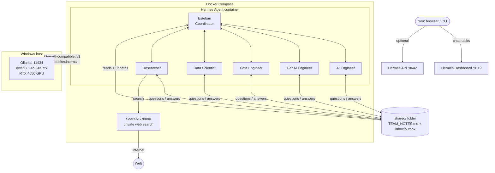

# Hermes Team – Architecture (single user, local)

## The three things that run
| # | Component | Where | Why |
|---|-----------|-------|-----|
| 1 | **Ollama + LLM** | Windows (native) | Direct GPU access, no WSL GPU passthrough overhead, saves RAM |
| 2 | **Hermes Agent** | Docker | Official image `nousresearch/hermes-agent`, one container, 6 profiles |
| 3 | **SearXNG** | Docker | Free self-hosted web search for the Researcher, no API keys |

## Agents (Hermes profiles)
Each profile = own SOUL.md (persona), memory, skills. All share `./shared`.

| Agent | Role |
|-------|------|
| **Esteban** | Coordinator. Receives all questions/answers, maintains `TEAM_NOTES.md`, assigns work |
| AI Engineer | Agent/ML systems, model serving, evaluation |
| GenAI Engineer | Prompts, RAG, LLM apps, fine-tuning |
| Data Engineer | Pipelines, storage, ETL, data quality |
| Data Scientist | Analysis, modelling, experiments, stock/product analytics |
| Researcher | Live internet research via SearXNG, returns sourced findings |

## Communication protocol (file based, fully automated)
1. An agent needing something writes `shared/inbox/esteban/<ts>-<from>.md` (question, or finished result).
2. Esteban reads his inbox, updates `shared/TEAM_NOTES.md` (decisions, status, open questions, answers).
3. Esteban writes `shared/inbox/<agent>/<ts>-esteban.md` with the answer/next task.
4. Agents read `TEAM_NOTES.md` + their inbox at the start of every turn.
5. Hermes cron jobs wake each agent periodically so no human is needed.

## Hardware budget (your laptop: 6 GB VRAM, 16 GB RAM)
- Ollama model ~3.5 GB VRAM + KV cache (q8, flash attention) for 64K context; overflow spills to RAM.
- Docker Desktop/WSL2 capped at ~5 GB RAM via `.wslconfig`.
- Only ONE model is loaded at a time → all agents share it (requests are queued).
- Fallback: set a cloud provider in `.env` for higher quality; nothing else changes.
